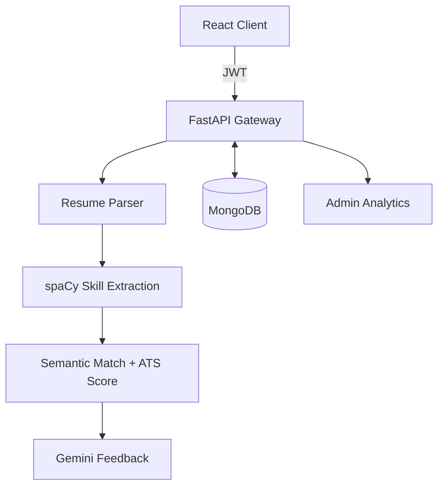

<!--
  NOTE (Aditya ke liye, GitHub pe dikhega nahi):
  "How I Build" aur project highlights me jo practices likhi hain (tests, CI, Swagger docs, etc.),
  sirf wahi rakhna jo repo me sach me hai. Recruiter repo khol ke check karte hain —
  jo claim repo me match kare wahi trust banata hai.
-->

  
  
  

  
  

---

## 👋 About Me

I'm a full-stack developer who likes taking an idea all the way from **schema design → API → UI → deployment**. Most of my work sits at the intersection of **MERN / FastAPI backends** and **applied NLP**, and I care as much about *how* a project is built as *what* it does — readable code, predictable APIs, and a setup anyone can run in one command.

- 🔭 **Building:** AI-powered tools and production-style full-stack systems
- 🌱 **Leveling up in:** System Design · Advanced NLP · Cloud Deployment
- 🤝 **Open to:** SDE / Full-Stack internships & roles, and open-source collaboration
- 💬 **Ask me about:** REST API design, JWT auth flows, Dockerizing MERN/FastAPI apps

---

## 🧪 How I Build

> Shipping is the floor, not the ceiling. These are the habits I follow across my projects.

| Practice | What it looks like in my repos |
|---|---|
| 🏗️ **Clean architecture** | Separate routes / controllers / services / models — business logic never lives in route handlers |
| 🔐 **Security first** | JWT auth with protected routes, hashed passwords, input validation, secrets in `.env` (never committed) |
| 🐳 **Reproducible setup** | Docker + `docker-compose` so the whole stack runs with one command |
| 📄 **Documentation** | Every repo has a README with features, architecture, setup steps and env variables; FastAPI services expose auto-generated Swagger docs |
| 🌿 **Git discipline** | Small, focused commits with meaningful messages; feature branches merged via PRs |
| ✅ **Testing** | API testing with Postman collections; unit tests for core logic (pytest / Jest) |
| 🚀 **Deployment** | Live demos on Vercel; environment-based config for dev vs prod |

---

## 🌟 Featured Project — AI Resume Analyzer

<table>
<tr>
<td width="55%" valign="top">

### 🤖 [AI Resume Analyzer](https://github.com/Aditya-9753/BTech-AI-Resume-Analyzer-AdityaTiwari)

A production-style resume evaluator that tells candidates **how well their resume matches a job** — and how to fix it.

**What it does**
- Extracts skills from resumes using **spaCy NLP**
- Scores resume ↔ job-description fit via **semantic similarity**
- **Simulates ATS screening** to flag formatting & keyword gaps
- Generates actionable feedback with **Google Gemini**
- **Admin analytics dashboard** for usage insights

**Engineering highlights**
- FastAPI backend with typed request/response models
- JWT-based auth with role separation (user / admin)
- MongoDB for flexible resume + analysis storage
- Fully **Dockerized** — frontend, backend & DB in one compose file

     

</td>
<td width="45%" valign="top">

**Architecture**

</td>
</tr>
</table>

---

## 🚀 More Projects

<table>
<tr>
<td width="50%" valign="top">

### 🔗 [LinkZap](https://github.com/Aditya-9753/Linnkzap) · [▶ Live](https://linnkzap-yd76.vercel.app/)
Secure **MERN URL shortener** with auto QR-code generation and a real-time analytics dashboard for clicks & usage.

**Shows:** auth-protected CRUD, analytics data modeling, Dockerized MERN stack, live deployment

   

</td>
<td width="50%" valign="top">

### 🏎️ [F1 Race Replay](https://github.com/Aditya-9753/F1-Race) · [▶ Live](https://f1-race-kappa.vercel.app)
Replays **real F1 telemetry** — live leaderboard, tyre data, per-driver speed / gear / DRS, with pause, rewind and speed controls.

**Shows:** working with large real-world datasets, time-series processing, interactive data visualization

  

</td>
</tr>
<tr>
<td width="50%" valign="top">

### 🗣️ [Interview Platform](https://github.com/Aditya-9753/Interview-Platform-)
Backend that models **real technical-interview workflows** — scheduling, rounds and candidate state — through clean REST APIs.

**Shows:** RESTful resource design, workflow/state modeling, structured error handling

  

</td>
<td width="50%" valign="top">

### 🔐 [CSMP — Secure Messaging Protocol](https://github.com/Aditya-9753/CSMP-)
A custom **secure messaging protocol** covering session management and real-time communication.

**Shows:** protocol design, session lifecycle handling, thinking about security and scale at the backend level

  

</td>
</tr>
<tr>
<td width="50%" valign="top">

### 🧠 [AI Research Assistant](https://github.com/Aditya-9753/Research-Assistant)
Parses natural-language research queries and returns context-aware, structured responses.

**Shows:** NLP query handling, LLM integration, automation pipelines

 

</td>
<td width="50%" valign="top">

### 📚 More on my profile
- **[LMS](https://github.com/Aditya-9753/LMS)** — MERN Learning Management System with courses & role-based access
- **[camonk-blog-app](https://github.com/Aditya-9753/camonk-blog-app)** — React + Vite blog platform

</td>
</tr>
</table>

---

## 🛠️ Tech Stack

<table align="center">
<tr>
<td align="center" width="130"><b>Frontend</b></td>
<td>
  
  
  
  
  
  
  
</td>
</tr>
<tr>
<td align="center"><b>Backend</b></td>
<td>
  
  
  
  
</td>
</tr>
<tr>
<td align="center"><b>Database</b></td>
<td>
  
  
</td>
</tr>
<tr>
<td align="center"><b>AI / ML</b></td>
<td>
  
  
  
</td>
</tr>
<tr>
<td align="center"><b>DevOps & Tools</b></td>
<td>
  
  
  
  
  
</td>
</tr>
</table>

---

## 📊 GitHub Activity

  

  

---

## 📫 Let's Connect

I'm actively looking for **SDE / Full-Stack opportunities**. If you're building something interesting, I'd love to talk.

  

<i>⭐ Consistency beats speed — one commit at a time.</i>

